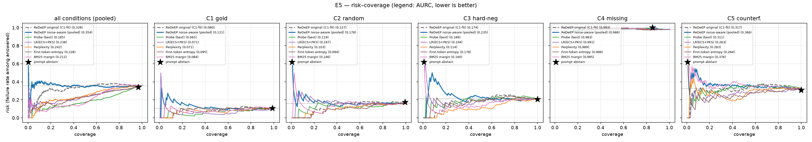

# Knowing When Not to Answer: predicting RAG failure from LLM internal states under retrieval noise

CS787 project. Base paper: ReDeEP (Sun et al., ICLR 2025). All numbers come from the frozen v2 run (2026-11-08) of Llama-2-7b-chat; sources are listed in section 9. Pooled out-of-fold predictions, 5-fold CV grouped by question, 95% CIs bootstrapped over questions (1000x).

## 1. Question
ReDeEP detects hallucination in RAG from two internal signals: the External Context Score (ECS, how much the final hidden state follows the context the copy heads attended to) and the Parametric Knowledge Score (PKS, how much late FFN layers push the answer from parametric memory). It fits its detector on clean, relevant context. We ask: **when retrieval is noisy, can internal signals still tell that the model is about to be wrong, and does a detector fitted on clean context survive noise?** A second question is practical: can such a detector support selective answering (abstaining when likely wrong)?

## 2. Setup
**Model.** Official `meta-llama/Llama-2-7b-chat-hf`, revision `f5db02db724555f92da89c216ac04704f23d4590`, fp16, greedy decoding. Identity, chat template and prompt rendering were verified on Kaggle before the run.

**Benchmark (v2, frozen).** 150 SQuAD-style questions x 5 retrieval conditions = 750 rows; all five conditions of a question share a fold.

| condition | passages |
|---|---|
| C1 gold | the gold passage only |
| C2 random | gold passage + 3 random passages |
| C3 hard negative | gold passage + 3 BM25 look-alikes that do not contain the answer |
| C4 missing | 3 look-alikes, gold passage removed (the model should abstain) |
| C5 counterfactual | gold passage + a copy with the answer replaced by a same-type fake |

Benchmark v2 differs from v1 only in the C5 replacement rule (v1 swaps were semantically poor); C1-C4 are identical for the shared questions and v1 is kept. Six questions were dropped because no clean C5 swap existed (listed in `benchmark_report_v2.md`).

**Generation.** Two prompt templates (standard, abstain-allowed). 128 new tokens; rows without EOS regenerated at 256; one abstain row still unfinished was regenerated alone at 512 (DEVIATIONS 4b). Final files: 750 rows per template, 0 truncated, 0 empty answers.

**Label.** Failure = not (answer contains a gold answer on token boundaries OR best token-F1 >= 0.5). For C4 any non-refusing answer is a failure; for C5 following the swapped answer is a failure. The stricter boundary rule changed 0 labels relative to the Day-1 substring rule.

**Detectors.** ReDeEP original (fitted on C1 only) and noise-aware (fitted on all conditions), ECS only, PKS only, logistic regression and MLP on ECS+PKS (+BM25 margin), linear probes on hidden states, perplexity, LN-entropy, first-token entropy, BM25 margin. A condition-prior detector is shown for reference only (not deployable). Threshold = F1-optimal on inner out-of-fold scores (nested CV: 5 outer, 3 inner folds).

**Frozen choices.** Head/layer ranking: signed Pearson r with respect to failure, ranked by |r|, original sign kept (the authors' AUROC ranking is reported only as a sensitivity analysis). The prompt, benchmark, folds, model revision and these settings are checksummed in `FROZEN_v2.json` and guarded by tests (30 pass). Nothing was changed after seeing results.

**Reproduction (E0).** On the authors' released RAGTruth data our pipeline gives AUC 0.7473 / PCC 0.4207 against the paper's 0.7458 / 0.4203 (ReDeEP chunk). One bug in the authors' evaluation script was fixed and documented.

## 3. Results

### 3.1 Noise hurts the model
Failure rate with the standard prompt: C1 10.7%, C2 16.0%, C3 21.3%, C4 98.0%, C5 32.7%. In C5, 25.3% of answers repeat the fake answer. The abstain-allowed prompt barely helps: C4 failure drops only to 85.3% (14.7% refusals), and prompt-based abstention covers 96.7% of questions at 34.1% risk.

### 3.2 ReDeEP does not detect failures within a condition
Within-condition AUROC (0.5 = chance; C4 is undefined because 147 of 150 rows fail):

| detector | C1 | C2 | C3 | C5 |
|---|---|---|---|---|
| ReDeEP original (C1-fit) | 0.54 | 0.51 | 0.51 | 0.47 |
| ReDeEP noise-aware (pooled) | 0.51 | 0.50 | 0.49 | 0.46 |
| ECS only | 0.49 | 0.44 | 0.50 | 0.43 |
| PKS only | 0.54 | 0.53 | 0.50 | 0.48 |
| *Sensitivity:* pooled, authors' AUROC ranking | 0.67 | 0.51 | 0.57 | 0.58 |
| *Sensitivity:* published hyperparameters | 0.69 | 0.46 | 0.60 | 0.62 |
| LR(ECS+PKS) | 0.70 | 0.50 | 0.58 | 0.59 |
| Probe, layer 2 of 3 (best single layer; one of three tried) | 0.72 | 0.60 | 0.51 | 0.43 |
| Probe, layer chosen by inner CV (the pre-specified "best") | 0.64 | 0.60 | 0.51 | 0.48 |
| Perplexity | 0.62 | 0.61 | 0.69 | 0.57 |
| LN-entropy | 0.65 | 0.61 | 0.72 | 0.55 |

With the frozen primary ranking, every ReDeEP variant is at chance inside every condition (all CIs include 0.5). Re-fitting on noisy data (our pooled version) did not rescue it, so the failure is not only a clean-to-noisy transfer problem. The extraction itself is sound: the token match with the model's own forward pass is 99.9%, and in C1 late-layer PKS is higher for failures (3.17 vs 2.53) as the method predicts.

### 3.3 The ranking rule matters
Using the authors' AUROC ranking instead of signed Pearson raises pooled ReDeEP from 0.514 to 0.615 overall (delta +0.10, CI [+0.05, +0.15]) and to 0.67 on C1. We report this as sensitivity, not as the main result, because the frozen protocol chose Pearson before the full run. The head and layer selection also looks unstable: the selected heads overlap little across folds (Jaccard 0 to 1.0), so conclusions about "which heads matter" should not be trusted at this sample size.

### 3.4 Other detectors
Learned detectors and simple output-uncertainty baselines do better than ReDeEP in places: LR(ECS+PKS) 0.70 on C1; probes 0.72 on C1 but 0.43 to 0.51 on C3 and C5; perplexity and LN-entropy 0.69 to 0.72 on C3. Probes trained on C2 and tested on other conditions stay at 0.5 to 0.6 (cross-noise transfer, E7). A diagnostic outside the plan: **answer length alone** gives within-condition AUROC 0.59, 0.57, 0.62, 0.56 on C1, C2, C3, C5, as informative as ReDeEP's best variants. The model opens 45% to 94% of answers (depending on condition) with a citation preamble ("According to Passage N"), so averaged token features partly reflect answer style.

### 3.5 Pooled "all" numbers are misleading
Pooled over all 750 rows, probes reach 0.78 to 0.80 and a **condition prior alone reaches 0.82**, because C4 is 98% failures. A detector that just recognises "evidence is missing" scores well pooled while detecting nothing about answer quality. Within-condition columns (3.2) are the honest measure.

### 3.6 Selective answering
Area under the risk-coverage curve (lower is better): oracle 0.073, probe layer 2 0.173 (probe chosen by inner CV: 0.185), probe layer 3 0.174, condition prior 0.179 (not deployable), LR+BM25 0.200, LR(ECS+PKS) 0.238, perplexity 0.242, ReDeEP original 0.328, ReDeEP pooled 0.354, answering everything 0.357. ReDeEP is barely better than never abstaining.

Figure: risk (failure rate among answered questions) against coverage for the original and noise-aware ReDeEP, the best probe, LR on ECS+PKS and the output baselines, pooled and per condition. The star marks prompt-based abstention, which answers almost everything (coverage 0.97) and keeps the risk at 0.34. In C1-C3 and C5 only the probe, perplexity and BM25-margin curves fall clearly below the no-abstention risk at low coverage; both ReDeEP curves stay at or above it. In C4 nothing helps because almost every answer is wrong.

### 3.7 The 20-prompt comparison
**Selection.** The 20 questions were drawn at random from the 150 benchmark questions with `seed = 1` (`make_comparison_set` in `src/data/noise_builder.py`, `artifacts/data/comparison_set_v2.json`). The set was written together with the benchmark on 2026-11-07 at 19:13, and its checksum is part of `FROZEN_v2.json`. The first model outputs on benchmark v2 came later (the 160-row pre-run at 21:12 the same day; the full run on 2026-11-08), so the set could not have been chosen by looking at outputs. One caveat: the same seed-1 draw on the first benchmark (v1) picked a different set, because six questions changed in v2 and only 10 of the 20 questions are shared; the v2 set is the one used throughout.

**Result.** For these 20 questions in all five conditions (100 cases) we compared what the model answered with what each ReDeEP version said. The original made the right call (answer vs abstain) in **58 of 100** cases and ours in **56 of 100**, so neither is much above chance.

Outcome counts per side and condition (kept-correct = answered and right; caught-failure = abstained and would have been wrong; missed-failure = answered and wrong; false-abstain = abstained although right):

| side | condition | kept-correct | caught-failure | missed-failure | false-abstain |
|---|---|---|---|---|---|
| orig | C1_gold | 13 | 1 | 1 | 5 |
| orig | C2_random | 13 | 1 | 2 | 4 |
| orig | C3_hardneg | 11 | 1 | 4 | 4 |
| orig | C4_missing | 0 | 6 | 14 | 0 |
| orig | C5_counterfactual | 10 | 2 | 4 | 4 |
| orig | all | 47 | 11 | 25 | 17 |
| ours | C1_gold | 9 | 1 | 1 | 9 |
| ours | C2_random | 11 | 2 | 1 | 6 |
| ours | C3_hardneg | 9 | 3 | 2 | 6 |
| ours | C4_missing | 0 | 12 | 8 | 0 |
| ours | C5_counterfactual | 6 | 3 | 3 | 8 |
| ours | all | 35 | 21 | 15 | 29 |

**Disagreements.** The two versions disagree on 48 of the 100 cases. **All 48 now have a one-line reason** (Appendix A): 9 were picked by hand from a fixed list of plausible explanations, and the other 39 are rule-based, computed from the score's distance to the cut-off, the answer length and the citation preamble in the token-level dump. All are hypotheses, not tested causes. The most frequent reason (32 of 48) is that one version's score lies within 0.02 of its cut-off; this is not specific to the disagreements, since scores are that close to the cut-off for 31% (original) and 50% (ours) of all 750 rows. Most disagreements are therefore near-threshold flips, not different judgements.

### 3.8 Qualitative examples (E9)
The 20 annotated examples are 15 random rows plus 5 C4 rows where the model answered; 5 of the 15 random rows also happened to be C4, so the sample holds **10 C4 rows, all wrong**, and 10 rows from other conditions (3 wrong, 7 right). The picks agreed with the automatic labels 20/20. On the 10 wrong C4 answers the probe score was high in 9 (0.67 to 1.00; one was 0.29), while the original ReDeEP was 0.30 or higher in only 4 of the 10. The 3 wrong answers in C2, C3 and C5 had low scores from all detectors. We read the probe's C4 success as recognising missing evidence, not as judging the answer.

### 3.9 Sign analysis (E3): is there a sign flip under noise?
This was the guide's central hypothesis. We computed, per condition and without any fitting, the correlation of failure with mean ECS (selected heads 17 and 30) and mean PKS (selected layers 13, 16, 17, 18, 19):

| condition | corr(ECS, failure) | corr(PKS, failure) |
|---|---|---|
| C1 gold | +0.11 | +0.33 |
| C2 random | +0.15 | +0.08 |
| C3 hard negative | +0.01 | +0.23 |
| C4 missing | +0.11 | 0.00 |
| C5 counterfactual | +0.03 | +0.29 |
| all | −0.02 | +0.28 |

The paper predicts ECS falls and PKS rises with failure. PKS goes the predicted way in C1, C3 and C5 (about +0.2 to +0.3) and is flat in C4. ECS is slightly positive in every condition, including clean C1, so it already has the "wrong" sign on clean data; we see no sign that flips because of noise, only weak ECS in all conditions. The mean ECS of failures vs correct answers in C1 is 0.296 vs 0.283, a tiny gap.

### 3.10 Ablation (E4)
Pooled AUROC: ECS only 0.504, PKS only 0.514, both (original ReDeEP) 0.506, noise-aware 0.514. Neither signal carries usable information on its own in our data; PKS is marginally better within C1 and C2 (0.54 and 0.53 vs ECS 0.49 and 0.44).

### 3.11 Cross-noise transfer (E7)
Training on C2 and testing elsewhere: ReDeEP 0.51 (C1), 0.55 (C3), 0.52 (C5); probe 0.59, 0.52, 0.58. These are as weak as the in-condition results, so nothing transfers and nothing is lost. C4 is undefined.

### 3.12 Other metrics (AUPRC, PCC)
AUPRC is only informative against the failure rate of each condition. For the original ReDeEP the within-condition AUPRC is 0.12 (C1), 0.16 (C2), 0.24 (C3), 0.30 (C5), against failure rates of 0.11, 0.16, 0.21 and 0.33, so it is at base rate. Pearson correlation of the ReDeEP score with failure is between −0.10 and +0.02 in every condition. Pooled, the probe has PCC 0.46 (mostly the condition effect, see 3.5).

## 4. Data-quality checks
- **Label hand check (40 rows, 8 per condition):** 92.5% agreement (37/40) against the 90% gate; C1 88%, C2 to C4 100%, C5 75%. The three disagreements are answers that hedge between the real and the swapped answer, or contain the gold phrase; no rule change was made.
- **C5 plausibility (all 150 swaps):** only 45% were judged plausible (what-questions 35%; when/who/how-many 71% to 83%). Plausible swaps were followed twice as often (35% vs 17%). Detector conclusions are unchanged on the plausible-only subset (ReDeEP 0.45 to 0.50).
- **Benchmark read (20 rows):** 20/20 OK. A code check over all 750 rows confirms the design: the gold answer is present in 150/150 rows of C1, C2, C3, C5 and absent in 150/150 rows of C4.

## 5. Limitations
- One model, 150 questions. C1 has only 16 failures, so C1 intervals are wide; C4 within-condition detection cannot be measured.
- Chat preamble and answer length confound token-averaged features; the prompt was frozen, so this is reported and not fixed.
- Only 45% of C5 swaps read as plausible, so C5 partly measures how a model reacts to odd text.
- The 40-row hand check has 3 disagreements, all in C1/C5; a larger check would tighten the label-quality estimate.
- "Why" reasons are hypotheses from a fixed list for 9 of 48 disagreements.
- Our ReDeEP is a re-implementation of the authors' definitions on stock transformers (hooks), not their fork; E0 shows the downstream evaluation reproduces, but the Llama-2 feature extraction on our data could differ in details.

## 6. Conclusions
1. Retrieval noise raises failure rates sharply (10.7% to 21% to 33% to 98%), and an abstain-allowed prompt does almost nothing to prevent C4 failures.
2. Under a protocol frozen before the full run, ReDeEP's ECS/PKS signals are at chance for predicting failures within a retrieval condition, even when re-fitted on noisy data. The authors' AUROC ranking gives a better result (section 3.3), and the choice of ranking rule changes the conclusion, which we could not resolve with 150 questions.
3. Pooled metrics are dominated by detecting the condition; simple baselines (output entropy, answer length) match ReDeEP within conditions.
4. Hidden-state probes are the best selective-answering signal here, but mostly because they identify missing evidence.

## 7. Deviations from the plan (all logged in `DEVIATIONS.md`)
C5 rule rebuilt (benchmark v2); token-boundary labels; 128/256/512 generation tiers; signed Pearson ranking frozen with AUROC as sensitivity; official Meta model pinned (a mirror was rejected); extraction re-implemented with hooks.

## 8. Reproducing
`kaggle_B_full_run.ipynb` and `kaggle_B2_resume.ipynb` produce the generations, features and labels (T4 x2). `python -m src.run_cpu_pipeline --run artifacts/runs/llama2-7b` produces all tables, figures and the comparison locally. `python -m pytest tests -q` runs the 30 tests.

## 9. Sources
Tables: `artifacts/results/llama2-7b/tables/tables.md`; figures: `.../figs/`; comparison: `.../comparison/`; human checks: `handcheck_40_labeled.csv`, `c5_validation_v2.csv`, `benchmark_read_20_result.csv`, `e9_notes.csv`; reproduction: `artifacts/results/e0_reproduction.json`.

## 10. Plan versus what we did
Checked against `FINAL_PLAN_V3.md` (which replaces the earlier execution plan).

**Done (mandatory scope):** Llama-2-7B-chat with greedy decoding; 150 questions x 5 conditions = 750 rows, validated; token-level ECS, PKS and ReDeEP score; original (clean-fit) vs noise-aware (pooled) ReDeEP; baselines (perplexity, LN-entropy, first-token entropy, BM25 margin, abstain prompt); cross-noise transfer; the 20-prompt comparison; reproduction of the paper (AUC 0.7473 / PCC 0.4207 vs 0.7458 / 0.4203); experiments E1 to E9; 40-row label hand check (92.5%); limitations.
**Done (optional scope):** logistic regression and MLP on ECS+PKS(+BM25), hidden-state probes, the paper's published hyperparameters, both prompt templates (standard and abstain).

**Not done (dropped or optional in V3, and in the earlier guide):** Llama-3-8B; a second dataset (TriviaQA; Natural Questions has no gold passages, so SQuAD 2.0 is the only data source); C6 sweeps over distractor count and gold position; the P(True) baseline; chunk-level ReDeEP on our data (used only in the paper reproduction); a GPU reproduction on RAGTruth; an LR using prompt attention mass. Evaluation uses 5-fold cross-validation grouped by question, not a 60/20/20 split.

---

## Appendix A: all 48 disagreements with a one-line reason

48 disagreements out of 100 cells. `why_source` = human-picked (cards 1-9, chosen by the project owner from a fixed list) or rule-based (computed from the score margins to each version's fold cut-off, the answer length and whether the answer starts with a citation preamble). All reasons are hypotheses read from the token-level dump and scores, not tested causes. `margin` = score minus the cut-off of the fold the question belongs to. Caveat: scores sit within 0.02 of the cut-off for 31% of all 750 rows (original) and 50% (ours), so most disagreements are near-threshold flips rather than genuine differences in judgement.

| # | Prompt | Cond. | LLM answer | Truth | Orig. | Ours | Right call | Reason | Source |
|---|---|---|---|---|---|---|---|---|---|
| 1 | What kind of needlework was used in the creation of the | C1 | Embroidery. | correct | answer | abstain | original | Short answer: only a few tokens, so the average is noisy | human-picked |
| 2 | What kind of needlework was used in the creation of the | C2 | According to Passage 2, the Bayeux Tapes | correct | answer | abstain | original | Long, hedged answer with a citation preamble, which shifts the averaged scores | human-picked |
| 3 | What kind of needlework was used in the creation of the | C3 | According to Passage 1, the Bayeux Tapes | correct | answer | abstain | original | Long, hedged answer with a citation preamble, which shifts the averaged scores | human-picked |
| 4 | What kind of needlework was used in the creation of the | C4 | The Bayeux Tapestry was created using em | wrong | answer | abstain | ours | Passages are misleading or missing evidence, so internal signals are not informative | human-picked |
| 5 | What kind of needlework was used in the creation of the | C5 | Embroidery. | correct | answer | abstain | original | Passages are misleading or missing evidence, so internal signals are not informative | human-picked |
| 6 | What is the largest stadium in Australia? | C1 | The largest stadium in Australia is the  | correct | answer | abstain | original | The two detectors use different cut-offs: the original was tuned on clean passages, ours on all five conditions | human-picked |
| 7 | What is the largest stadium in Australia? | C2 | According to Passage 3, the largest stad | correct | answer | abstain | original | Long, hedged answer with a citation preamble, which shifts the averaged scores | human-picked |
| 8 | What is the largest stadium in Australia? | C3 | According to Passage 4, the largest stad | correct | answer | abstain | original | Long, hedged answer with a citation preamble, which shifts the averaged scores | human-picked |
| 9 | What is the largest stadium in Australia? | C4 | According to Passage 3, the largest stad | wrong | answer | abstain | ours | Passages are misleading or missing evidence, so internal signals are not informative | human-picked |
| 10 | What is the largest stadium in Australia? | C5 | According to the passages, the largest s | correct | answer | abstain | original | Long answer that starts with a citation preamble, which dilutes the averaged scores | rule-based |
| 11 | When was the colony destroyed? | C5 | According to the passages, the colony wa | correct | abstain | answer | ours | Score within 0.02 of the cut-off for one version (margins +0.029 orig, -0.001 ours), so a small difference flips the call | rule-based |
| 12 | Who described a steam turbine in 1629? | C1 | Giovanni Branca. | correct | abstain | answer | ours | Score within 0.02 of the cut-off for one version (margins +0.004 orig, -0.022 ours), so a small difference flips the call | rule-based |
| 13 | Who described a steam turbine in 1629? | C2 | Giovanni Branca described a steam turbin | correct | abstain | answer | ours | Different head/layer selections and cut-offs give different scores on this answer | rule-based |
| 14 | Who described a steam turbine in 1629? | C3 | Giovanni Branca described a steam turbin | correct | abstain | answer | ours | Score within 0.02 of the cut-off for one version (margins +0.031 orig, -0.008 ours), so a small difference flips the call | rule-based |
| 15 | Who described a steam turbine in 1629? | C5 | Giovanni Branca described a steam turbin | correct | abstain | answer | ours | Different head/layer selections and cut-offs give different scores on this answer | rule-based |
| 16 | Stretched rocks that pinch into lenses are known by wha | C1 | Boudins. | correct | answer | abstain | original | Score within 0.02 of the cut-off for one version (margins -0.015 orig, +0.026 ours), so a small difference flips the call | rule-based |
| 17 | Stretched rocks that pinch into lenses are known by wha | C2 | According to Passage 3, stretched rocks  | correct | answer | abstain | original | Long answer that starts with a citation preamble, which dilutes the averaged scores | rule-based |
| 18 | Stretched rocks that pinch into lenses are known by wha | C3 | According to Passage 4, stretched rocks  | correct | answer | abstain | original | Long answer that starts with a citation preamble, which dilutes the averaged scores | rule-based |
| 19 | Stretched rocks that pinch into lenses are known by wha | C4 | From Passage 3: "Lenses" | wrong | answer | abstain | ours | Score within 0.02 of the cut-off for one version (margins -0.017 orig, +0.032 ours), so a small difference flips the call | rule-based |
| 20 | What are some large pharmacy management companies? | C1 | According to Passage 1, some large pharm | correct | answer | abstain | original | Score within 0.02 of the cut-off for one version (margins -0.000 orig, +0.039 ours), so a small difference flips the call | rule-based |
| 21 | What are some large pharmacy management companies? | C2 | According to Passage 3, some large pharm | correct | answer | abstain | original | Score within 0.02 of the cut-off for one version (margins -0.015 orig, +0.049 ours), so a small difference flips the call | rule-based |
| 22 | What are some large pharmacy management companies? | C3 | According to Passage 4, some large pharm | wrong | answer | abstain | ours | Score within 0.02 of the cut-off for one version (margins -0.014 orig, +0.046 ours), so a small difference flips the call | rule-based |
| 23 | What are some large pharmacy management companies? | C4 | Based on the passages provided, some lar | wrong | answer | abstain | ours | Evidence is missing, so the answer is wrong whatever the signals say; the two versions use different cut-offs and head sets | rule-based |
| 24 | What are some large pharmacy management companies? | C5 | According to the passages, some large ph | wrong | answer | abstain | ours | Score within 0.02 of the cut-off for one version (margins -0.004 orig, +0.036 ours), so a small difference flips the call | rule-based |
| 25 | What river is located in the vicinity of the school? | C1 | Passage 1 mentions the Charles River, wh | correct | answer | abstain | original | Score within 0.02 of the cut-off for one version (margins -0.212 orig, +0.001 ours), so a small difference flips the call | rule-based |
| 26 | What river is located in the vicinity of the school? | C5 | According to Passage 1 and Passage 2, th | correct | answer | abstain | original | Score within 0.02 of the cut-off for one version (margins -0.208 orig, +0.007 ours), so a small difference flips the call | rule-based |
| 27 | When there are many workers competing for a few jobs it | C1 | Low demand and high supply. | correct | answer | abstain | original | Score within 0.02 of the cut-off for one version (margins -0.194 orig, +0.006 ours), so a small difference flips the call | rule-based |
| 28 | When there are many workers competing for a few jobs it | C3 | According to Passage 1, when there are m | correct | answer | abstain | original | Score within 0.02 of the cut-off for one version (margins -0.195 orig, +0.001 ours), so a small difference flips the call | rule-based |
| 29 | When there are many workers competing for a few jobs it | C4 | In the context of the passages provided, | wrong | answer | abstain | ours | Score within 0.02 of the cut-off for one version (margins -0.179 orig, +0.006 ours), so a small difference flips the call | rule-based |
| 30 | When there are many workers competing for a few jobs it | C5 | Low demand and low wages. | correct | answer | abstain | original | Score within 0.02 of the cut-off for one version (margins -0.205 orig, +0.004 ours), so a small difference flips the call | rule-based |
| 31 | What does the Riemann hypothesis state the source of ir | C1 | According to the passage, the source of  | correct | abstain | answer | ours | Score within 0.02 of the cut-off for one version (margins +0.016 orig, -0.003 ours), so a small difference flips the call | rule-based |
| 32 | What does the Riemann hypothesis state the source of ir | C2 | According to Passage 1, the source of ir | correct | abstain | answer | ours | Score within 0.02 of the cut-off for one version (margins +0.045 orig, -0.005 ours), so a small difference flips the call | rule-based |
| 33 | What does the Riemann hypothesis state the source of ir | C3 | According to Passage 2, the source of ir | correct | abstain | answer | ours | Score within 0.02 of the cut-off for one version (margins +0.025 orig, -0.008 ours), so a small difference flips the call | rule-based |
| 34 | At what size and larger can drugs elicit a neutralizing | C4 | According to Passage 3, drugs can elicit | wrong | answer | abstain | ours | Score within 0.02 of the cut-off for one version (margins -0.022 orig, +0.003 ours), so a small difference flips the call | rule-based |
| 35 | What is the largest suspension bridge in Germany? | C5 | According to Passage 2, the largest susp | correct | answer | abstain | original | Score within 0.02 of the cut-off for one version (margins -0.199 orig, +0.002 ours), so a small difference flips the call | rule-based |
| 36 | What does the Nederrikn's name change into? | C1 | According to Passage 1, the Nederrijn's  | correct | abstain | answer | ours | Score within 0.02 of the cut-off for one version (margins +0.005 orig, -0.018 ours), so a small difference flips the call | rule-based |
| 37 | What does the Nederrikn's name change into? | C2 | According to Passage 3, the Nederrijn's  | correct | abstain | answer | ours | Score within 0.02 of the cut-off for one version (margins +0.022 orig, -0.014 ours), so a small difference flips the call | rule-based |
| 38 | What does the Nederrikn's name change into? | C3 | According to Passage 3, the Nederrijn's  | correct | abstain | answer | ours | Score within 0.02 of the cut-off for one version (margins +0.024 orig, -0.015 ours), so a small difference flips the call | rule-based |
| 39 | What does the Nederrikn's name change into? | C4 | According to Passage 1, the name "Nederr | wrong | abstain | answer | original | Score within 0.02 of the cut-off for one version (margins +0.028 orig, -0.003 ours), so a small difference flips the call | rule-based |
| 40 | What does the Nederrikn's name change into? | C5 | According to the passages provided, the  | wrong | abstain | answer | original | Score within 0.02 of the cut-off for one version (margins +0.001 orig, -0.004 ours), so a small difference flips the call | rule-based |
| 41 | What was the seat of former party leader David McLetchi | C1 | Edinburgh Pentlands. | correct | answer | abstain | original | Very short answer (5 tokens), so the token average is noisy | rule-based |
| 42 | What was the seat of former party leader David McLetchi | C2 | According to Passage 1, the seat of form | correct | answer | abstain | original | Score within 0.02 of the cut-off for one version (margins -0.016 orig, +0.032 ours), so a small difference flips the call | rule-based |
| 43 | What was the seat of former party leader David McLetchi | C3 | According to Passage 2, the seat of form | correct | answer | abstain | original | Score within 0.02 of the cut-off for one version (margins -0.018 orig, +0.033 ours), so a small difference flips the call | rule-based |
| 44 | What was the seat of former party leader David McLetchi | C4 | According to Passage 1, David McLetchie  | wrong | answer | abstain | ours | Score within 0.02 of the cut-off for one version (margins -0.015 orig, +0.039 ours), so a small difference flips the call | rule-based |
| 45 | What was the seat of former party leader David McLetchi | C5 | Edinburgh Pentlands. | correct | answer | abstain | original | Score within 0.02 of the cut-off for one version (margins -0.018 orig, +0.021 ours), so a small difference flips the call | rule-based |
| 46 | What are the laws of physics of Galileo, in reference t | C2 | According to Passage 1, Galileo's insigh | wrong | answer | abstain | ours | Score within 0.02 of the cut-off for one version (margins -0.011 orig, +0.033 ours), so a small difference flips the call | rule-based |
| 47 | What are the laws of physics of Galileo, in reference t | C3 | According to Passage 3, Galileo's laws o | wrong | answer | abstain | ours | Score within 0.02 of the cut-off for one version (margins -0.004 orig, +0.029 ours), so a small difference flips the call | rule-based |
| 48 | What are the laws of physics of Galileo, in reference t | C5 | According to the passages, the laws of p | wrong | answer | abstain | ours | Score within 0.02 of the cut-off for one version (margins -0.006 orig, +0.034 ours), so a small difference flips the call | rule-based |

### Outcome counts per condition (20 prompts)

Outcomes: kept-correct (answered, right), caught-failure (abstained, would have been wrong), missed-failure (answered, wrong), false-abstain (abstained, would have been right).

| side   | condition         |   kept-correct |   caught-failure |   missed-failure |   false-abstain |
|:-------|:------------------|---------------:|-----------------:|-----------------:|----------------:|
| orig   | C1_gold           |             13 |                1 |                1 |               5 |
| orig   | C2_random         |             13 |                1 |                2 |               4 |
| orig   | C3_hardneg        |             11 |                1 |                4 |               4 |
| orig   | C4_missing        |              0 |                6 |               14 |               0 |
| orig   | C5_counterfactual |             10 |                2 |                4 |               4 |
| orig   | all               |             47 |               11 |               25 |              17 |
| ours   | C1_gold           |              9 |                1 |                1 |               9 |
| ours   | C2_random         |             11 |                2 |                1 |               6 |
| ours   | C3_hardneg        |              9 |                3 |                2 |               6 |
| ours   | C4_missing        |              0 |               12 |                8 |               0 |
| ours   | C5_counterfactual |              6 |                3 |                3 |               8 |
| ours   | all               |             35 |               21 |               15 |              29 |

---

## Appendix B: complete metrics (pooled out-of-fold predictions, 95% bootstrap CIs over questions, 1000 resamples)

AUROC and AUPRC are n/a where a condition has fewer than 10 failures or 10 successes (C4). Base rate of failure per condition: C1 0.107, C2 0.160, C3 0.213, C4 0.980, C5 0.327, all 0.357 (AUPRC is only meaningful against these).

### all  (n=750, failures=268)

| detector | AUROC [95% CI] | AUPRC [95% CI] | PCC [95% CI] | AURC |
|---|---|---|---|---|
| ReDeEP original (C1-fit) | 0.506 [0.466, 0.547] | 0.347 [0.310, 0.398] | -0.030 [-0.096, 0.036] | 0.328 |
| ReDeEP noise-aware (pooled) | 0.514 [0.468, 0.565] | 0.392 [0.340, 0.459] | 0.001 [-0.071, 0.076] | 0.354 |
| ReDeEP original, AUROC ranking (sensitivity) | 0.509 [0.467, 0.553] | 0.358 [0.326, 0.403] | -0.057 [-0.108, -0.001] | 0.344 |
| ReDeEP noise-aware, AUROC ranking (sensitivity) | 0.615 [0.570, 0.662] | 0.483 [0.417, 0.552] | 0.204 [0.130, 0.278] | 0.280 |
| ReDeEP published hparams (O1) | 0.609 [0.562, 0.657] | 0.471 [0.411, 0.540] | 0.194 [0.119, 0.269] | 0.278 |
| ECS only | 0.504 [0.456, 0.550] | 0.373 [0.329, 0.431] | 0.002 [-0.077, 0.078] | 0.347 |
| PKS only | 0.514 [0.475, 0.552] | 0.359 [0.325, 0.407] | -0.022 [-0.085, 0.043] | 0.324 |
| LR(ECS+PKS) | 0.678 [0.627, 0.728] | 0.527 [0.466, 0.599] | 0.296 [0.213, 0.379] | 0.238 |
| LR(ECS+PKS+BM25) | 0.739 [0.696, 0.786] | 0.607 [0.546, 0.675] | 0.400 [0.328, 0.473] | 0.200 |
| MLP(ECS+PKS) | 0.667 [0.623, 0.714] | 0.514 [0.462, 0.580] | 0.260 [0.187, 0.334] | 0.240 |
| Probe L1 | 0.781 [0.746, 0.818] | 0.672 [0.627, 0.731] | 0.490 [0.431, 0.551] | 0.180 |
| Probe L2 | 0.797 [0.764, 0.831] | 0.735 [0.696, 0.782] | 0.523 [0.467, 0.582] | 0.173 |
| Probe L3 | 0.795 [0.764, 0.827] | 0.716 [0.677, 0.767] | 0.516 [0.462, 0.571] | 0.174 |
| Probe (best) | 0.771 [0.733, 0.808] | 0.643 [0.597, 0.704] | 0.461 [0.398, 0.523] | 0.185 |
| Perplexity | 0.642 [0.597, 0.689] | 0.451 [0.398, 0.517] | 0.156 [0.076, 0.241] | 0.242 |
| LN-entropy | 0.656 [0.611, 0.704] | 0.467 [0.410, 0.531] | 0.187 [0.107, 0.272] | 0.235 |
| First-token entropy | 0.683 [0.647, 0.719] | 0.526 [0.478, 0.579] | 0.193 [0.100, 0.314] | 0.228 |
| BM25 margin | 0.689 [0.655, 0.724] | 0.452 [0.409, 0.504] | 0.345 [0.290, 0.403] | 0.212 |
| Condition prior (not deployable) | 0.820 [0.783, 0.858] | 0.788 [0.755, 0.824] | 0.660 [0.602, 0.721] | 0.179 |

### C1_gold  (n=150, failures=16)

| detector | AUROC [95% CI] | AUPRC [95% CI] | PCC [95% CI] | AURC |
|---|---|---|---|---|
| ReDeEP original (C1-fit) | 0.544 [0.414, 0.671] | 0.119 [0.070, 0.216] | 0.009 [-0.127, 0.160] | 0.080 |
| ReDeEP noise-aware (pooled) | 0.508 [0.312, 0.689] | 0.197 [0.072, 0.377] | 0.010 [-0.163, 0.192] | 0.121 |
| ReDeEP original, AUROC ranking (sensitivity) | 0.475 [0.316, 0.631] | 0.108 [0.061, 0.201] | -0.059 [-0.172, 0.098] | 0.108 |
| ReDeEP noise-aware, AUROC ranking (sensitivity) | 0.665 [0.484, 0.809] | 0.299 [0.132, 0.533] | 0.240 [0.026, 0.429] | 0.066 |
| ReDeEP published hparams (O1) | 0.691 [0.535, 0.827] | 0.275 [0.120, 0.502] | 0.230 [0.056, 0.387] | 0.056 |
| ECS only | 0.487 [0.309, 0.672] | 0.157 [0.070, 0.340] | -0.009 [-0.194, 0.185] | 0.131 |
| PKS only | 0.538 [0.395, 0.676] | 0.120 [0.068, 0.216] | 0.006 [-0.144, 0.157] | 0.083 |
| LR(ECS+PKS) | 0.695 [0.531, 0.833] | 0.277 [0.134, 0.528] | 0.237 [0.027, 0.430] | 0.071 |
| LR(ECS+PKS+BM25) | 0.661 [0.488, 0.819] | 0.279 [0.118, 0.532] | 0.236 [0.017, 0.430] | 0.066 |
| MLP(ECS+PKS) | 0.694 [0.541, 0.824] | 0.199 [0.110, 0.365] | 0.220 [0.029, 0.411] | 0.066 |
| Probe L1 | 0.611 [0.471, 0.744] | 0.143 [0.082, 0.275] | 0.030 [-0.077, 0.184] | 0.069 |
| Probe L2 | 0.721 [0.613, 0.824] | 0.204 [0.118, 0.367] | 0.179 [0.035, 0.346] | 0.044 |
| Probe L3 | 0.715 [0.588, 0.828] | 0.202 [0.114, 0.355] | 0.133 [0.010, 0.307] | 0.048 |
| Probe (best) | 0.642 [0.497, 0.767] | 0.163 [0.092, 0.314] | 0.061 [-0.054, 0.214] | 0.065 |
| Perplexity | 0.618 [0.473, 0.757] | 0.178 [0.087, 0.357] | 0.116 [-0.054, 0.294] | 0.071 |
| LN-entropy | 0.647 [0.512, 0.771] | 0.214 [0.091, 0.387] | 0.149 [-0.021, 0.329] | 0.063 |
| First-token entropy | 0.527 [0.366, 0.677] | 0.139 [0.076, 0.295] | -0.027 [-0.074, 0.126] | 0.095 |
| BM25 margin | 0.574 [0.437, 0.716] | 0.128 [0.072, 0.216] | 0.065 [-0.068, 0.180] | 0.084 |
| Condition prior (not deployable) | 0.374 [0.237, 0.506] | 0.092 [0.053, 0.139] | -0.159 [-0.321, 0.007] | 0.128 |

### C2_random  (n=150, failures=24)

| detector | AUROC [95% CI] | AUPRC [95% CI] | PCC [95% CI] | AURC |
|---|---|---|---|---|
| ReDeEP original (C1-fit) | 0.506 [0.400, 0.614] | 0.155 [0.102, 0.239] | -0.023 [-0.164, 0.122] | 0.127 |
| ReDeEP noise-aware (pooled) | 0.497 [0.366, 0.626] | 0.170 [0.106, 0.283] | 0.017 [-0.135, 0.177] | 0.178 |
| ReDeEP original, AUROC ranking (sensitivity) | 0.500 [0.370, 0.619] | 0.172 [0.108, 0.283] | -0.029 [-0.165, 0.119] | 0.178 |
| ReDeEP noise-aware, AUROC ranking (sensitivity) | 0.507 [0.366, 0.641] | 0.203 [0.114, 0.351] | 0.041 [-0.149, 0.230] | 0.168 |
| ReDeEP published hparams (O1) | 0.462 [0.324, 0.593] | 0.158 [0.099, 0.265] | -0.066 [-0.228, 0.097] | 0.186 |
| ECS only | 0.441 [0.331, 0.553] | 0.151 [0.096, 0.260] | -0.073 [-0.218, 0.071] | 0.179 |
| PKS only | 0.534 [0.416, 0.650] | 0.172 [0.113, 0.273] | 0.007 [-0.130, 0.155] | 0.130 |
| LR(ECS+PKS) | 0.498 [0.357, 0.634] | 0.179 [0.113, 0.315] | -0.006 [-0.175, 0.166] | 0.167 |
| LR(ECS+PKS+BM25) | 0.513 [0.376, 0.642] | 0.194 [0.118, 0.361] | 0.019 [-0.150, 0.182] | 0.163 |
| MLP(ECS+PKS) | 0.447 [0.325, 0.587] | 0.144 [0.092, 0.232] | -0.080 [-0.205, 0.087] | 0.170 |
| Probe L1 | 0.633 [0.513, 0.758] | 0.267 [0.156, 0.449] | 0.171 [-0.013, 0.363] | 0.101 |
| Probe L2 | 0.597 [0.453, 0.732] | 0.279 [0.165, 0.474] | 0.169 [-0.021, 0.355] | 0.140 |
| Probe L3 | 0.602 [0.465, 0.724] | 0.223 [0.142, 0.368] | 0.136 [-0.039, 0.310] | 0.126 |
| Probe (best) | 0.596 [0.459, 0.721] | 0.225 [0.141, 0.379] | 0.113 [-0.053, 0.279] | 0.119 |
| Perplexity | 0.608 [0.497, 0.720] | 0.240 [0.152, 0.408] | 0.161 [-0.035, 0.354] | 0.103 |
| LN-entropy | 0.611 [0.493, 0.734] | 0.282 [0.160, 0.440] | 0.162 [-0.027, 0.350] | 0.106 |
| First-token entropy | 0.639 [0.530, 0.739] | 0.224 [0.149, 0.365] | 0.100 [-0.027, 0.251] | 0.094 |
| BM25 margin | 0.534 [0.407, 0.656] | 0.202 [0.123, 0.364] | 0.037 [-0.141, 0.177] | 0.146 |
| Condition prior (not deployable) | 0.421 [0.306, 0.532] | 0.140 [0.093, 0.205] | -0.106 [-0.249, 0.039] | 0.184 |

### C3_hardneg  (n=150, failures=32)

| detector | AUROC [95% CI] | AUPRC [95% CI] | PCC [95% CI] | AURC |
|---|---|---|---|---|
| ReDeEP original (C1-fit) | 0.509 [0.402, 0.608] | 0.243 [0.159, 0.362] | -0.053 [-0.192, 0.088] | 0.174 |
| ReDeEP noise-aware (pooled) | 0.486 [0.373, 0.612] | 0.261 [0.169, 0.398] | -0.007 [-0.157, 0.157] | 0.235 |
| ReDeEP original, AUROC ranking (sensitivity) | 0.485 [0.381, 0.597] | 0.206 [0.142, 0.302] | -0.131 [-0.249, 0.006] | 0.223 |
| ReDeEP noise-aware, AUROC ranking (sensitivity) | 0.571 [0.453, 0.690] | 0.393 [0.243, 0.543] | 0.193 [-0.005, 0.359] | 0.184 |
| ReDeEP published hparams (O1) | 0.600 [0.473, 0.720] | 0.365 [0.235, 0.533] | 0.135 [-0.051, 0.304] | 0.190 |
| ECS only | 0.497 [0.378, 0.622] | 0.264 [0.172, 0.427] | -0.025 [-0.184, 0.141] | 0.220 |
| PKS only | 0.502 [0.403, 0.609] | 0.212 [0.148, 0.325] | -0.048 [-0.190, 0.097] | 0.180 |
| LR(ECS+PKS) | 0.575 [0.463, 0.683] | 0.313 [0.198, 0.464] | 0.120 [-0.064, 0.285] | 0.194 |
| LR(ECS+PKS+BM25) | 0.629 [0.515, 0.748] | 0.400 [0.255, 0.558] | 0.217 [0.039, 0.379] | 0.158 |
| MLP(ECS+PKS) | 0.522 [0.394, 0.641] | 0.304 [0.184, 0.458] | 0.030 [-0.139, 0.194] | 0.212 |
| Probe L1 | 0.517 [0.413, 0.627] | 0.223 [0.152, 0.338] | 0.006 [-0.142, 0.165] | 0.192 |
| Probe L2 | 0.511 [0.407, 0.618] | 0.247 [0.165, 0.371] | 0.006 [-0.148, 0.159] | 0.191 |
| Probe L3 | 0.551 [0.440, 0.653] | 0.258 [0.174, 0.394] | 0.068 [-0.091, 0.224] | 0.189 |
| Probe (best) | 0.512 [0.410, 0.609] | 0.210 [0.146, 0.307] | -0.042 [-0.159, 0.086] | 0.189 |
| Perplexity | 0.691 [0.594, 0.788] | 0.366 [0.246, 0.542] | 0.228 [0.060, 0.420] | 0.114 |
| LN-entropy | 0.718 [0.622, 0.809] | 0.416 [0.280, 0.601] | 0.305 [0.116, 0.486] | 0.107 |
| First-token entropy | 0.527 [0.426, 0.629] | 0.227 [0.157, 0.349] | -0.003 [-0.128, 0.138] | 0.178 |
| BM25 margin | 0.619 [0.509, 0.717] | 0.304 [0.198, 0.444] | 0.159 [0.000, 0.296] | 0.160 |
| Condition prior (not deployable) | 0.365 [0.263, 0.473] | 0.172 [0.121, 0.240] | -0.197 [-0.349, -0.037] | 0.286 |

### C4_missing  (n=150, failures=147)

| detector | AUROC [95% CI] | AUPRC [95% CI] | PCC [95% CI] | AURC |
|---|---|---|---|---|
| ReDeEP original (C1-fit) | n/a | n/a | -0.081 [-0.210, 0.051] | 0.993 |
| ReDeEP noise-aware (pooled) | n/a | n/a | -0.059 [-0.212, 0.144] | 0.986 |
| ReDeEP original, AUROC ranking (sensitivity) | n/a | n/a | -0.067 [-0.307, 0.089] | 0.984 |
| ReDeEP noise-aware, AUROC ranking (sensitivity) | n/a | n/a | -0.053 [-0.255, 0.136] | 0.985 |
| ReDeEP published hparams (O1) | n/a | n/a | -0.109 [-0.194, -0.039] | 0.994 |
| ECS only | n/a | n/a | -0.062 [-0.219, 0.138] | 0.987 |
| PKS only | n/a | n/a | -0.072 [-0.240, 0.097] | 0.990 |
| LR(ECS+PKS) | n/a | n/a | -0.048 [-0.126, 0.032] | 0.991 |
| LR(ECS+PKS+BM25) | n/a | n/a | -0.094 [-0.177, -0.013] | 0.993 |
| MLP(ECS+PKS) | n/a | n/a | -0.003 [-0.103, 0.117] | 0.984 |
| Probe L1 | n/a | n/a | -0.008 [-0.155, 0.205] | 0.982 |
| Probe L2 | n/a | n/a | -0.061 [-0.193, 0.109] | 0.986 |
| Probe L3 | n/a | n/a | -0.031 [-0.221, 0.240] | 0.982 |
| Probe (best) | n/a | n/a | -0.039 [-0.192, 0.182] | 0.983 |
| Perplexity | n/a | n/a | -0.032 [-0.132, 0.058] | 0.989 |
| LN-entropy | n/a | n/a | -0.047 [-0.148, 0.045] | 0.991 |
| First-token entropy | n/a | n/a | 0.010 [-0.055, 0.078] | 0.986 |
| BM25 margin | n/a | n/a | -0.091 [-0.142, -0.044] | 0.995 |
| Condition prior (not deployable) | n/a | n/a | -0.117 [-0.181, -0.062] | 0.989 |

### C5_counterfactual  (n=150, failures=49)

| detector | AUROC [95% CI] | AUPRC [95% CI] | PCC [95% CI] | AURC |
|---|---|---|---|---|
| ReDeEP original (C1-fit) | 0.472 [0.383, 0.568] | 0.301 [0.235, 0.412] | -0.098 [-0.229, 0.050] | 0.317 |
| ReDeEP noise-aware (pooled) | 0.456 [0.359, 0.554] | 0.329 [0.245, 0.448] | -0.057 [-0.216, 0.103] | 0.366 |
| ReDeEP original, AUROC ranking (sensitivity) | 0.468 [0.373, 0.565] | 0.315 [0.236, 0.416] | -0.160 [-0.295, -0.024] | 0.333 |
| ReDeEP noise-aware, AUROC ranking (sensitivity) | 0.577 [0.475, 0.680] | 0.454 [0.333, 0.595] | 0.175 [0.017, 0.315] | 0.278 |
| ReDeEP published hparams (O1) | 0.616 [0.523, 0.712] | 0.462 [0.343, 0.602] | 0.195 [0.048, 0.351] | 0.243 |
| ECS only | 0.432 [0.337, 0.526] | 0.312 [0.229, 0.441] | -0.099 [-0.261, 0.047] | 0.371 |
| PKS only | 0.478 [0.378, 0.571] | 0.311 [0.239, 0.423] | -0.088 [-0.234, 0.056] | 0.332 |
| LR(ECS+PKS) | 0.588 [0.490, 0.678] | 0.429 [0.322, 0.580] | 0.173 [0.002, 0.324] | 0.263 |
| LR(ECS+PKS+BM25) | 0.611 [0.516, 0.705] | 0.472 [0.345, 0.619] | 0.203 [0.045, 0.349] | 0.253 |
| MLP(ECS+PKS) | 0.600 [0.506, 0.686] | 0.423 [0.318, 0.572] | 0.129 [-0.039, 0.274] | 0.248 |
| Probe L1 | 0.493 [0.398, 0.591] | 0.311 [0.239, 0.420] | -0.036 [-0.185, 0.125] | 0.300 |
| Probe L2 | 0.431 [0.335, 0.530] | 0.288 [0.222, 0.391] | -0.116 [-0.272, 0.045] | 0.362 |
| Probe L3 | 0.453 [0.358, 0.554] | 0.307 [0.231, 0.428] | -0.078 [-0.230, 0.080] | 0.352 |
| Probe (best) | 0.477 [0.380, 0.576] | 0.301 [0.231, 0.404] | -0.077 [-0.220, 0.080] | 0.311 |
| Perplexity | 0.567 [0.469, 0.660] | 0.362 [0.272, 0.493] | 0.037 [-0.092, 0.204] | 0.283 |
| LN-entropy | 0.554 [0.456, 0.654] | 0.357 [0.268, 0.494] | 0.028 [-0.111, 0.195] | 0.291 |
| First-token entropy | 0.606 [0.512, 0.700] | 0.424 [0.319, 0.571] | 0.152 [0.000, 0.314] | 0.264 |
| BM25 margin | 0.500 [0.500, 0.500] | 0.327 [0.260, 0.407] | n/a | 0.376 |
| Condition prior (not deployable) | 0.385 [0.300, 0.479] | 0.274 [0.213, 0.360] | -0.198 [-0.335, -0.054] | 0.405 |
